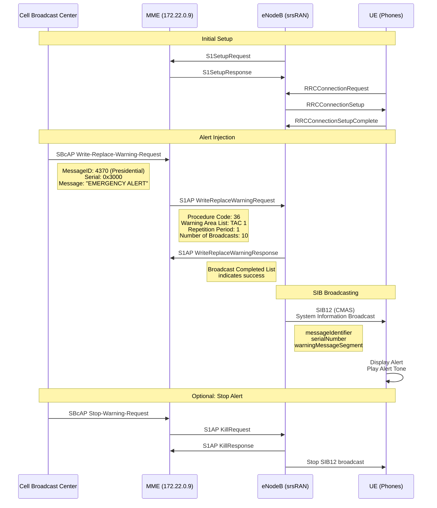
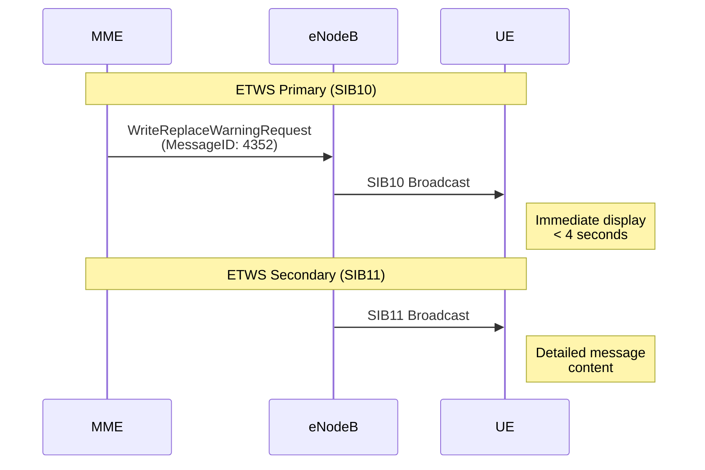
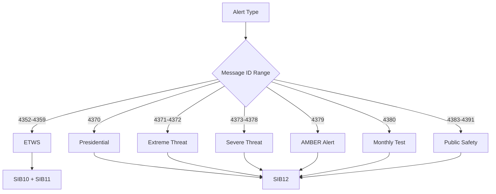
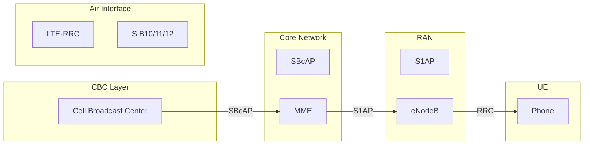
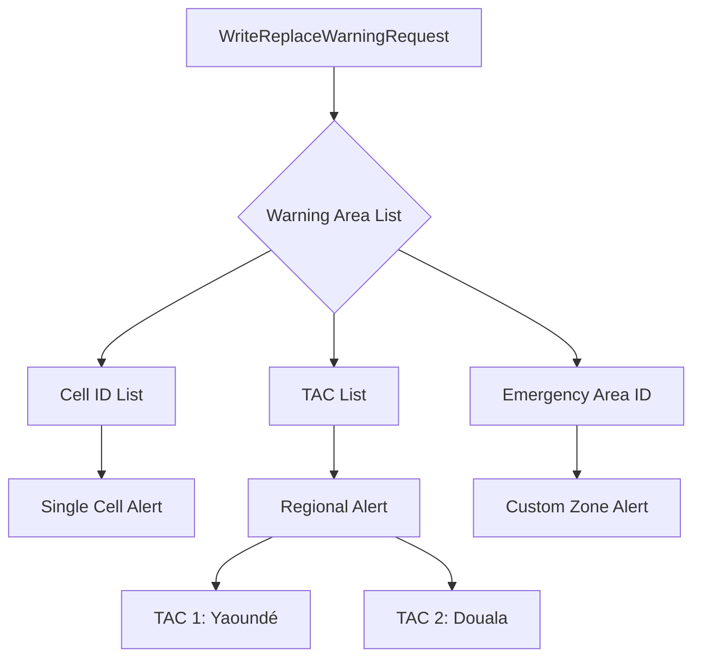

# PWS Message Flow — Write-Replace-Warning

## Complete S1AP Sequence

## ETWS Flow (Earthquake/Tsunami)

## Message ID Mapping

## Protocol Stack

## Warning Area Targeting

---

*Generated: 2026-10-01*  
*Reference: 3GPP TS 36.413, TS 23.041*
